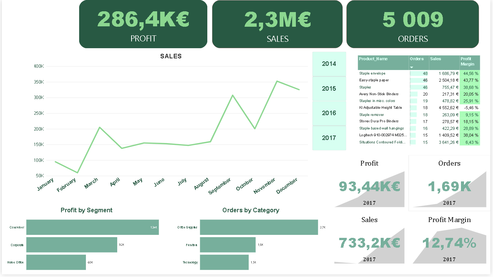

# Data-Analysis-Project
# Sales Analytics – Superstore Dataset

## Project Overview

This project focuses on analyzing sales data from a fictional retail store using SQL Server and Power BI. The main objective is to explore business performance, identify sales trends, evaluate profitability, and extract insights that can support better business decisions.

The project is part of my data analytics portfolio and demonstrates practical skills in SQL querying, data preparation, business analysis, and data visualization.

## Tools & Technologies

- **SQL Server (SSMS 22)** – Data exploration, preparation, and analysis.
- **Power BI** – Data visualization and interactive dashboard development.
- **Microsoft Excel / CSV** – Dataset handling.
- **GitHub** – Project documentation and version control.

## Dataset

The project uses the Sample Superstore dataset, which contains retail sales transaction data.

The dataset includes:

- Order and shipping dates
- Customer names and IDs
- Product names and categories
- Sales and profit
- Quantity sold
- Discounts
- Geographic regions

Dataset source: [Sample Superstore – Kaggle](https://www.kaggle.com/datasets/vivek468/superstore-dataset-final)

## SQL Analysis

After importing the dataset into SQL Server, I performed data preparation and analytical queries to explore business performance.

The analysis covers:

1. **Total Sales and Profit** – Calculating overall sales and profit.
2. **Number of Orders** – Identifying the total number of unique orders.
3. **Best-Selling Products** – Finding products with the highest sales volume based on quantity sold.
4. **Profit by Category** – Comparing profitability across product categories.
5. **Sales by Region** – Analyzing sales performance across different regions.
6. **Monthly Sales** – Identifying monthly sales trends.
7. **Top 10 Customers** – Finding the customers generating the highest total profit.
8. **Discount Analysis** – Evaluating the relationship between discount levels and profitability.

### Data Preparation

The dataset was imported into SQL Server and column data types were adjusted to ensure that numerical values, dates, and text fields could be used correctly in the analysis.

The SQL queries used for the project are available in the repository.

## Power BI Dashboard

An interactive Power BI dashboard was developed to visualize key business metrics and explore sales performance.

The dashboard includes:

- KPI cards for Total Profit, Total Sales, and Number of Orders
- Monthly Sales Trend
- Profit by Customer Segment
- Orders by Product Category
- Product performance table
- Year selection filters
- Additional yearly KPIs for Profit, Sales, Orders, and Profit Marginň

  

## Key Business Insights

Based on the dashboard:

- Total sales reached approximately **€2.3 million**, generating **€286.4 thousand in profit**.
- The dataset contains **5,009 unique orders**.
- The **Consumer** segment generated the highest profit, approximately **€134 thousand**.
- **Office Supplies** had the highest order volume, with approximately **3.7 thousand orders**.

These findings provide an overview of the store's sales performance and profitability across different business segments and product categories.

## Skills Demonstrated

- Data preparation and data quality checks
- SQL querying and aggregation
- Common Table Expressions (CTEs)
- Conditional logic using CASE statements
- Business data analysis
- DAX measures and Power BI visualizations
- Interactive dashboard development
- Interpreting and communicating business insights

**Project:** Sales Analytics – Superstore Dataset  
**Author:** Data Analytics Portfolio Project
